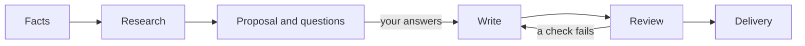

<div align="center">

<h1>Prompt Generator</h1>

<h3>Your idea, shaped for the model that will run it.</h3>

A Cursor workspace that researches your target model, agrees the plan with you,</br> then writes and reviews a ready-to-paste prompt.

**Designed to be run by mid-tier models**. You do not need a top-tier model to use it.

<br>

[](./LICENSE)
[](https://cursor.com)

[Why](#why-prompt-generator)&nbsp;&nbsp;|&nbsp;&nbsp;[How it works](#how-it-works)&nbsp;&nbsp;|&nbsp;&nbsp;[Quick start](#quick-start)&nbsp;&nbsp;|&nbsp;&nbsp;[What you get](#what-you-get)&nbsp;&nbsp;|&nbsp;&nbsp;[Models](#supported-models)&nbsp;&nbsp;|&nbsp;&nbsp;[Layout](#repository-layout)

</div>

---

## Why Prompt Generator

Each model family wants its prompts written differently, and the advice changes with every release. This workspace turns what you say in plain language into a prompt that fits the exact model you name.

- **Researched, not remembered.** The agent looks up the vendor's current documentation for your model, and how people get the kind of result you want.
- **Agreed before written.** You see a proposed flow and answer questions first, so the prompt reflects your decisions.
- **Reviewed before delivery.** Every prompt is checked against a fixed list, and you are told what had to be fixed.

The instructions are written for mid-tier models: numbered steps with clear stop points, fixed output formats, and a review before delivery, so less is left to the model's judgment. This is about the model that runs the generator; the prompt it writes can target any model.

It is a set of Cursor rules and skills, not an application: there is nothing to build or install.

## How it works



| Step | What happens |
| --- | --- |
| **1. Facts** | Target model, effort, where the prompt will run, what it should do, and any local project involved. Everything missing is asked at once, as clickable questions when the host supports them. |
| **2. Model guidance** | The official page for the family, from `sources.md`, then the live documentation for the exact model. |
| **3. Plugins** | The enabled plugins of the host that will run the prompt, checked fresh each time, so it can name the ones that already cover part of the task. |
| **4. Task research** | Order of work, tools, common failures, and how to check the result. |
| **5. Align** | A short proposed flow with the pages it comes from, then up to four clickable questions with a recommended answer. |
| **6. Write and review** | One prompt, checked and corrected before you see it. |

Asking to "write it now" still gets the alignment step. To skip it, say explicitly that you want the prompt without questions; the assumptions made are then listed.

**Refining an existing prompt** follows the same research. The agent diagnoses the prompt first, and if the best change differs from the one you asked for, it proposes it and waits.

## Quick start

### Requirements

- [Cursor](https://cursor.com), with network access so the agent can read vendor documentation
- The name of the model that will run your prompt

### Setup

```bash
git clone https://github.com/oriolescserr/prompt-generator.git
```

Open the `prompt-generator` folder as your Cursor workspace, pick a mid-tier model, and set its effort to `high` in the model picker.

### Ask

```text
Create a prompt for …
Write a prompt that …
Tighten this prompt for <model> <effort>: …
```

If your task belongs to another repository, give its path so the prompt is grounded in real files.

## What you get

| Item | Detail |
| --- | --- |
| **Model and effort** | Which setting to use, and where to set it in the product or API |
| **Sources** | The pages opened during that session |
| **Review** | One line with the result, plus what had to be fixed or is still unmet |
| **Prompt** | One copyable block, in English unless you ask for another language |
| **Where to paste it** | Including any files or data to attach |
| **Plugins** | Each plugin the prompt names and why, or why it names none |
| **Expected result** | Up to five plain lines, in the language you chatted in |

Refinements also explain what changed and why.

### The review

| Check | Passes when |
| --- | --- |
| Self-contained | Nothing has to be guessed by a reader who only has the prompt |
| Agreed decisions | Your answers and the accepted proposals are all in it |
| Done is checkable | Every completion criterion says how to verify it |
| No weak spot | The poorest result that would still obey the prompt is ruled out |
| No conflicts | No contradictions, repetitions, or vague criteria |
| Fits the model | Structure and effort setting match the documentation |
| Lean | Every sentence changes what the model does |
| Nothing lost | Everything you asked for is in it, unless you agreed to drop it |

The full definition is in [`quality.md`](./.cursor/skills/create-prompt/quality.md).

## Supported models

The main model families have their official pages listed in [`sources.md`](./.cursor/skills/create-prompt/sources.md), with a few technical traps to check. Other providers work too, from the live search.

No prompting advice is stored per model: it changes with every release, so it is read from the vendor each time.

## Repository layout

```text
.cursor/
  rules/
    prompt-specialist.mdc    # routing, language, rules for every turn
  skills/
    create-prompt/           # new prompts
      SKILL.md
      plugins.md             # checking the host's plugins
      quality.md             # prompt contents, review, delivery format
      sources.md             # official pages and traps per model family
    refine-prompt/           # changes to existing prompts
      SKILL.md
```

## License

Released under the [MIT License](./LICENSE). Copyright © 2026 Oriol Escolà Serra.
